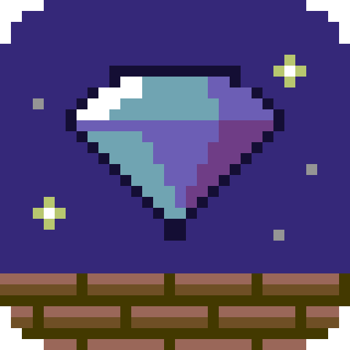

<p align="center"></p>

# The Great Giana Sisters – native port

A native PC version of the 1987 C64 classic *The Great Giana Sisters*, written in Rust.

This is **not an emulator**. The game logic was ported routine by routine from the original 6502 program and checked,
frame by frame, against the real thing running in a C64 emulator. The result plays like the C64 version – same jumps,
same enemies, same music from the original sound driver – but runs as a normal program with a proper menu, controller
support, fullscreen and network play.

## Why this exists

I built this for my dad. He played Giana Sisters back in the day, and I wanted us to be able to play it together
again – on our own PCs, over the network, without fiddling with emulator settings. That's also why there are things
the original never had: high scores with names, a two-player network mode where you both play at the same time, and a
"who got further wins" rule he asked for.

It's a hobby project and I probably won't have much time to keep working on it. **Forks, pull requests and
contributions are very welcome** – if you want to fix something, add a platform or take it further, go for it.
See [Contributing](#contributing) for a few starting points.

## What you need

- **Your own copy of the original game as a `.g64` disk image.** This repository and the downloads contain no game
  data at all – no graphics, music, levels or ROMs. On first start the game asks for your disk image and extracts
  what it needs.
- Currently one version of the disk is supported (SHA-256 of the `.g64`):
  `5ce29ce04786eca6518fb08dfe659abb3eee079b4135a3f7606f9d17a501ec77`.
  Other versions are refused with a clear message. Supporting more versions mostly means adding their checksums and
  checking the extraction – a nice first contribution.

## Install

Download the package for your system from the [Releases](../../releases) page:

| System | File | Notes |
|---|---|---|
| Linux (x86_64) | `giana-sisters-native-<version>-linux-x86_64.tar.gz` | needs SDL2: `sudo apt install libsdl2-2.0-0` or `sudo dnf install SDL2` |
| Windows (x86_64) | `giana-sisters-native-<version>-windows-x86_64.zip` | unsigned: in SmartScreen click "More info" → "Run anyway" |
| macOS (Apple Silicon and Intel) | `giana-sisters-native-<version>-macos-universal.tar.gz` | unsigned: right-click "Giana Sisters.app" → Open the first time |

Unpack it and start the game. On the first start it asks for your disk image: drag the `.g64` onto the window, type
or paste its path, or let it search the usual folders (Downloads, Documents, your home folder). That's it – after that it starts straight into the
menu. (From the command line: `giana-app --import /path/to/disk.g64`.)

The game checks GitHub once a day for a new version and shows a notice in the main menu; press `U` (or `X` on a
controller) to update. Downloads are verified against the release's `SHA256SUMS.txt` before anything is replaced.
You can switch the check off under OPTIONS → UPDATE CHECK, or start with `--no-update-check`.

## Playing

| Action | Keyboard | Controller |
|---|---|---|
| Move | ← → or A D | D-pad or left stick |
| Duck | ↓ or S | D-pad down |
| Jump | Space, ↑ or W | B / ○ |
| Fire | X, Left Ctrl or Z | A / ✕, right trigger |
| Item (clock or bomb) | C | Y / △ |
| Pause menu | Esc | Start |

Everything can be rebound under KEYBOARD and CONTROLLER in the menu; the hints at the bottom of the screen always show
your current keys, and switch between keyboard and controller icons depending on what you last used. Xbox,
PlayStation and Switch controllers get their own button icons.

Other keys: `F11` or `Alt+Enter` for fullscreen, `M` to mute.

As on a real C64, the item key also fires: on the original the space bar shares a wire with the joystick's fire
button.

### Two players

- **2 PLAYERS** – Giana and Maria take turns on one computer, like in the original.
- **NETWORK → HOST SAME TIME** – both of you play your own game at the same time on two computers. A copy of the
  other game runs alongside, and whoever is out can watch the other one.
- **NETWORK → HOST TAKE TURNS** – one shared game with the original's turns; the other computer watches.

Whoever hosts picks the winner rule: **SCORE** (higher score wins) or **FURTHEST** (higher stage wins, score breaks
a tie). The original names no winner – that's our addition.

For network play the host has to allow **port 47064 (TCP and UDP)** – on Fedora for example
`sudo firewall-cmd --add-port=47064/tcp --add-port=47064/udp`. Both computers need the **same version** of the game;
different builds refuse to play together instead of drifting apart. Computers in the same network find each other
automatically; otherwise type the host's address.

### Options

- **Fullscreen**, and **scaling**: *whole pixels* (sharp, with the C64 border), *no border* (sharp and as large as
  possible – 5× on a 1920×1080 screen) or *fill screen*.
- **Display 50 Hz**: the game runs at 50 frames per second like a European C64. In fullscreen it picks a 50, 100,
  150 or 200 Hz mode if your monitor has one, so every frame is shown evenly.
- **Sound**: master volume, separate music and effects volume, and menu sounds (soft, classic or off). With both
  sliders at full, the sound is exactly the original mix.
- **Mode: ORIGINAL / ENHANCED**. ORIGINAL is the game as it was. ENHANCED switches on changes a purist might not want,
  currently *smooth motion*: on 60/120/144 Hz monitors the picture is moved smoothly between the C64's frames.

Settings, controls and high scores live in `~/.config/giana-native/` (Linux and macOS) or `%APPDATA%\giana-native\`
(Windows). The extracted game data lives in `~/.local/share/giana-native/data/` (Linux),
`%APPDATA%\giana-native\data\` (Windows) or `~/Library/Application Support/giana-native/data/` (macOS); a `data`
folder next to the program works too, and `--data DIR` picks any other place.

### Command line

```
giana-app [OPTIONS]

    --import FILE.g64  extract the game data from your original disk image and exit
    --data DIR         use the original game data in DIR (extract into it on first start)
    --stage N          skip the menu and start in stage N (1 to 33)
    --debug            debug keys: F1 lives, F2 invulnerable, F3/F4 previous/next stage
    --check-update     look for a new version now, print the result and exit
    --no-update-check  never look for a new version (also OPTIONS > UPDATE CHECK)
    -h, --help         show this text
    -V, --version      show the version
```

## Building from source

You need Rust (stable, via [rustup](https://rustup.rs/)), a C compiler and the SDL2 development files
(`sudo dnf install SDL2-devel`, `sudo apt install libsdl2-dev` or `brew install sdl2`).

```bash
cargo build --release -p giana-app
./target/release/giana-app          # asks for your .g64 on the first start
cargo test --workspace
```

`./run.sh` builds on first use and starts the game. `cargo build --release -p giana-app --features bundled-sdl`
builds SDL2 from source and links it in (that's how the Windows and macOS releases are made).

### How it's put together

| Crate | What it does |
|---|---|
| `giana-core` | the game logic – the actual port, in fixed 50 Hz steps |
| `giana-render` | draws the picture the way the C64's video chip would |
| `giana-audio` | runs the ported sound driver on a SID chip model |
| `giana-app` | window, input, menus, high scores, network play, options, updates |
| `giana-extract` | reads the game out of your `.g64` (no ROMs needed) |

## How faithful is it?

During development every part of the game logic was compared with the original running in an emulator: walking,
jumping, every enemy type and boss, power-ups, the bonus room, warps, the status bar, the ending and the sound driver's
output, across all 33 stages. Known differences are tiny: after some deaths the restart can be one frame off, and a
few waits are measured rather than computed cycle by cycle. You shouldn't be able to feel any of it while playing.
If you do notice something that behaves differently from the C64 version, please open an issue.

## Contributing

Bug reports, fixes and forks are all welcome. Some ideas if you're looking for something to do:

- support more versions of the original disk (other `.g64` or `.d64` releases)
- a widescreen mode (needs care: enemies appear when the screen edge reaches them)
- signed Windows/macOS builds, Flatpak or other packages
- more controller layouts, Steam Deck testing
- translations of the menus

Please keep the ORIGINAL mode faithful – changes to how the game plays belong behind the ENHANCED switch.

## Legal

This repository and its releases contain **no game data**. You need your own copy of the original game. The code is
a port – a translation – of the original program into Rust; it contains no disk images, ROMs, graphics, music or level
files of the original. "The Great Giana Sisters" and all related names and characters belong to their respective
owners. This project is not affiliated with or endorsed by them.

## Credits

- *The Great Giana Sisters* (1987) by Rainbow Arts – game design by Armin Gessert, graphics by Manfred Trenz,
  music by Chris Hülsbeck. All the good parts are theirs.
- [resid-rs](https://crates.io/crates/resid-rs), a Rust port of reSID, for the SID sound
- [SDL2](https://www.libsdl.org/) for window, input and audio
- [ureq](https://crates.io/crates/ureq), rustls and friends for the update check

## License

GPL-3.0-or-later, see [LICENSE](LICENSE). The license covers the code of this port, not the original game, whose
rights stay with their owners.
