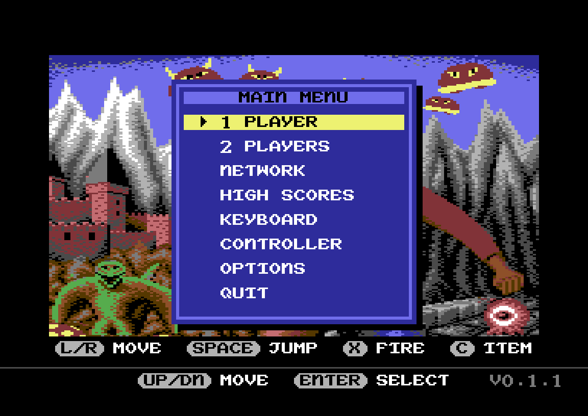
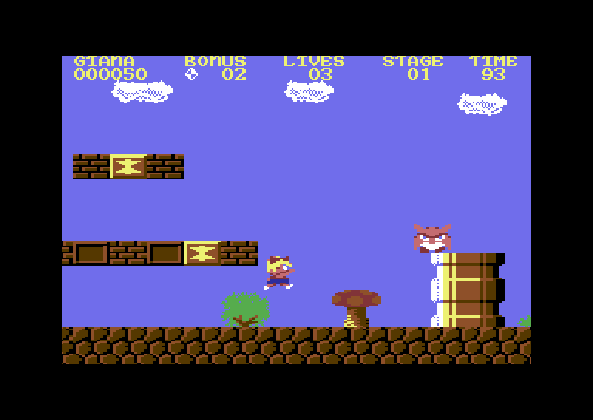
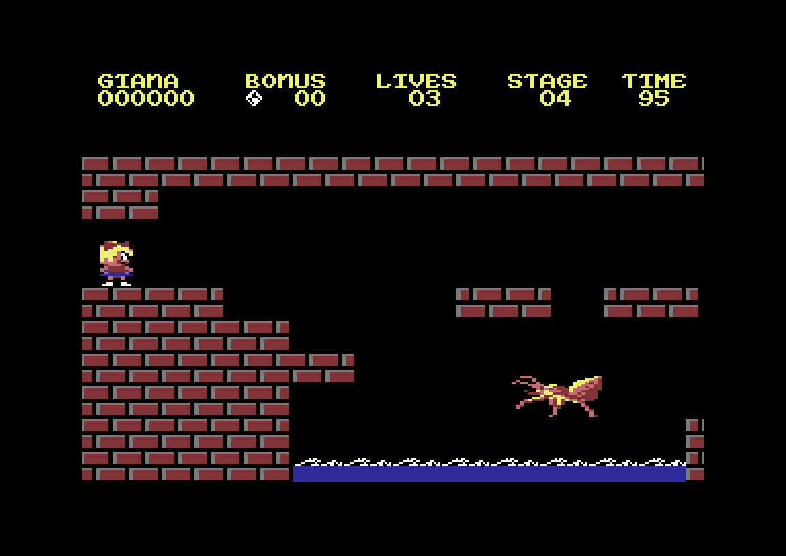

# The Great Giana Sisters – native port

A native PC version of the 1987 C64 classic *The Great Giana Sisters*, written in Rust.

This is **not an emulator**: the game was ported routine by routine and plays like the C64 version – same jumps, same
enemies, same music – but runs as a normal program with a menu, controller support, fullscreen and network play.

The one part that is emulated is the sound chip. Chris Hülsbeck's music and sound effect driver is ported like the rest
of the game, so it decides which note plays when and writes the same SID registers as on the C64. Those registers then
go to [resid-rs](https://crates.io/crates/resid-rs), the reSID chip model that VICE uses as well, because the C64's
sound comes from an analog chip (oscillators, envelopes, filter) that can be modelled but not ported.

  
  
  

## Why this exists

I built this for my dad. He played Giana Sisters back in the day, and I wanted us to be able to play it together
again – on our own PCs, over the network, without fiddling with emulator settings. That's also why there are things
the original never had: high scores with names, a two-player network mode where you both play at the same time, and a
"who got further wins" rule he asked for.

It's a hobby project and I probably won't have much time to keep working on it. **Forks, pull requests and
contributions are very welcome** – if you want to fix something, add a platform or take it further, go for it.
See [Contributing](#contributing) for a few starting points.

## What you need

**Your own copy of the original game as a `.g64` or `.d64` disk image.** The downloads contain no game data at all. On
the first start the game asks for your disk image and takes what it needs from it.

Any dump of the original disk works, as long as the game files on it are unmodified: the game compares the program and
title files on the disk (not the whole image file) with the original, so different dumps and both formats are fine.
Cracked or modified versions are refused with a clear message.

## Install

Download the package for your system from the [Releases](../../releases) page, unpack it and start it:

| System | File | Notes |
|---|---|---|
| Linux (x86_64) | `giana-sisters-native-<version>-linux-x86_64.tar.gz` | run `./install.sh` for a menu entry, or just `./giana-app` |
| Windows (x86_64) | `giana-sisters-native-<version>-windows-x86_64.zip` | unsigned: in SmartScreen click "More info" → "Run anyway" |
| macOS (Apple Silicon and Intel) | `giana-sisters-native-<version>-macos-universal.tar.gz` | not notarized: open it once, then System Settings → Privacy & Security → "Open Anyway" (older macOS: right-click → Open) |

Linux needs nothing else installed. Details, uninstall and updates: [docs/guide.md](docs/guide.md).

## First start

The game shows a page that asks for your disk image. Do one of these:

- click **CHOOSE FILE...** (or press Enter) and pick the `.g64` or `.d64`,
- drag the disk image onto the window, or onto the app icon,
- type or paste its path, or let the game search Downloads, Documents and your home folder (only if you choose that).

After that the game starts straight into the menu. From a terminal: `giana-app --import /path/to/disk.g64` (or `.d64`).
On Linux the file dialog needs the desktop portal or zenity; without one, use drag and drop.

## Controls

| Action | Keyboard | Controller |
|---|---|---|
| Move | ← → or A D | D-pad or left stick |
| Duck | ↓ or S | D-pad down |
| Jump | Space, ↑ or W | B / ○ |
| Fire | X, Left Ctrl or Z | A / ✕, right trigger |
| Item (clock or bomb) | C | Y / △ |
| Pause menu | Esc | Start |

Everything can be rebound in the menu. `F11` or `Alt+Enter` is fullscreen, `M` mutes.

## More to try

- **Stop any time:** close the program in the middle of a game and *CONTINUE* in the main menu brings it back where you were.
- **Two players:** take turns on one computer, or play at the same time over the network (the host opens port 47064).
- **ROM modules:** fan-made versions of the game (other levels, graphics, music) play as `.grom` modules. Choose *ROM
  MODULES* in the main menu and add the hack's disk image or a `.grom` file.
- **Authentic mode:** shows exactly what the C64 showed, including the original title and high score screens.

Everything else – options, network play, ROM modules, authentic mode, command line, where your files are – is in the
[player's guide](docs/guide.md). Building from source and how the port works: [docs/building.md](docs/building.md).

## Contributing

Bug reports, fixes and forks are welcome. Ideas: support more versions of the original disk, a widescreen mode, signed
Windows/macOS builds, Flatpak, more controller layouts, translations. Please keep ORIGINAL mode faithful; changes to
how the game plays belong behind the ENHANCED switch. See [docs/building.md](docs/building.md) to get started.

## Legal

This repository and its releases contain **no game data**. You need your own copy of the original game. The code is
a port – a translation – of the original program into Rust; it contains no disk images, ROMs, graphics, music or level
files of the original. "The Great Giana Sisters" and all related names and characters belong to their respective
owners. This project is not affiliated with or endorsed by them.

The screenshots in this README show the original game's graphics and are included for illustration only; the rights remain
with their owners.

## Credits

- *The Great Giana Sisters* (1987) by Rainbow Arts – game design by Armin Gessert, graphics by Manfred Trenz,
  music by Chris Hülsbeck. All the good parts are theirs.
- [resid-rs](https://crates.io/crates/resid-rs), a Rust port of reSID, for the SID sound
- [SDL2](https://www.libsdl.org/) for window, input and audio
- [ureq](https://crates.io/crates/ureq), rustls and friends for the update check

## License

GPL-3.0-or-later, see [LICENSE](LICENSE). The license covers the code of this port, not the original game, whose
rights stay with their owners.
