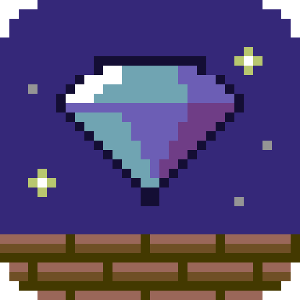
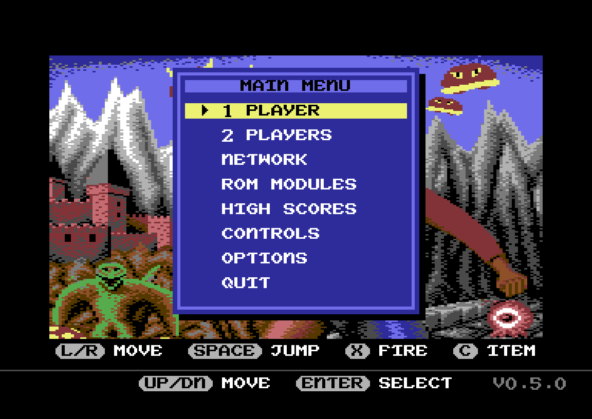
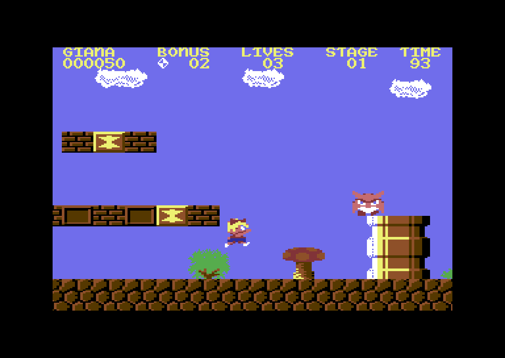
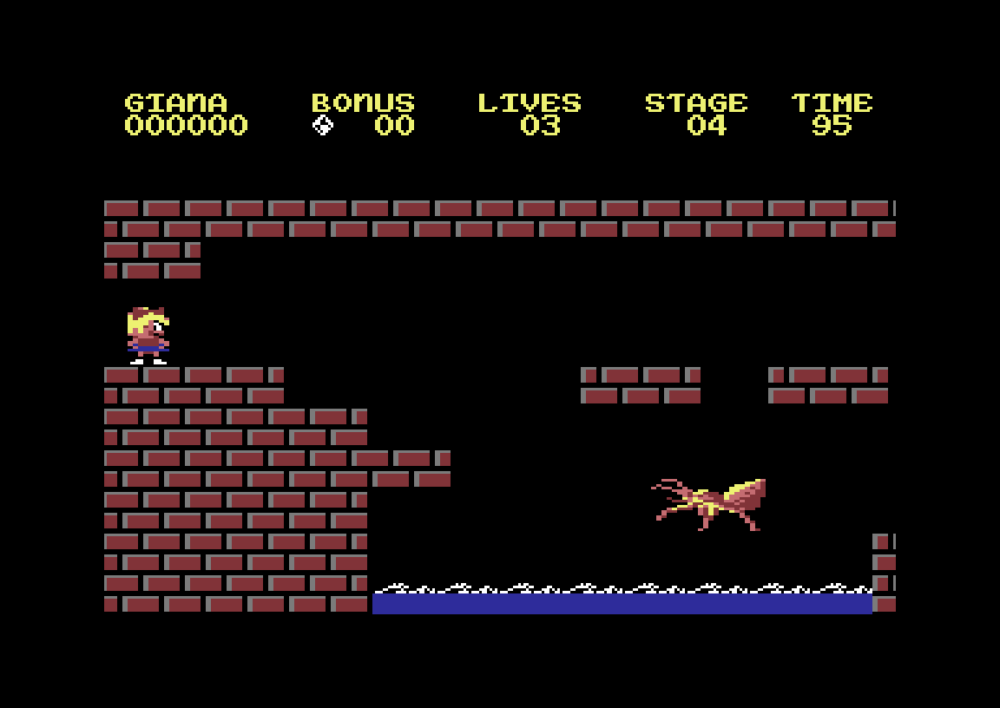

<p align="center"></p>

<h1 align="center">The Great Giana Sisters – native port</h1>

<p align="center">
  The 1987 C64 classic, ported routine by routine to Rust. Not an emulator. Bring your own disk image.
</p>

<p align="center">
  <a href="https://github.com/kvnshroom/giana-sisters-native/actions/workflows/ci.yml"></a>
  <a href="https://github.com/kvnshroom/giana-sisters-native/releases/latest"></a>
  <a href="https://github.com/kvnshroom/giana-sisters-native/releases"></a>
  <a href="LICENSE"></a>
</p>

<p align="center">
  
  
  
</p>

## About

A native PC version of *The Great Giana Sisters* (Rainbow Arts, 1987). The 6502 game logic was translated into Rust
routine by routine and checked frame by frame against the original, so it plays like the C64 version – same jumps,
same enemies, same music – but runs as a normal program with a menu, controller support, fullscreen and network play.

The one emulated part is the sound chip: Chris Hülsbeck's sound driver is ported like the rest of the game and writes
the same SID registers as on the C64; those go to [reSIDfp](https://github.com/libsidplayfp/libresidfp) (libresidfp),
the chip model of sidplayfp and of current VICE, because the SID's analog sound can be modelled but not ported.

**Why:** I built this for my dad. He played Giana Sisters back in the day, and I wanted us to play it together again,
on our own PCs, over the network. That's why there are things the original never had: high scores with names,
two players at the same time over the network, and a "who got further wins" rule he asked for.

## Features

- Plays like the C64 original; ORIGINAL mode stays faithful, extras are options.
- Menus, pause menu, rebindable keyboard and controller, fullscreen, sharp or CRT picture, optional widescreen.
- High scores with names, and close the game any time: *CONTINUE* brings it back where you were.
- Two players: take turns on one computer, or play at the same time over the network.
- **ROM modules:** fan-made versions of the game (other levels, graphics, music, own engines) as `.grom` files.
- **30th Anniversary preview** (demo 2.0, from your own `.d64`, local only): the whole demo natively, from the intro
  to the ending, with its pause menu, stage select, treasure rooms and high scores.
- **Authentic mode:** exactly what the C64 showed, including the original title and high score screens.

## What you need

**Your own copy of the original game as a `.g64` or `.d64` disk image.** The downloads contain no game data. On the
first start the game asks for your disk image and takes what it needs from it. Any dump of the original disk works;
cracked or modified versions are refused with a clear message.

## Install

Download the package for your system from the [latest release](https://github.com/kvnshroom/giana-sisters-native/releases/latest),
unpack it and start it:

| System | File | Notes |
|---|---|---|
| Linux (x86_64) | `giana-sisters-native-<version>-linux-x86_64.tar.gz` | `./install.sh` for a menu entry, or just `./giana-app` |
| Linux (64-bit ARM, e.g. Raspberry Pi 4/5) | `giana-sisters-native-<version>-linux-aarch64.tar.gz` | same as Linux x86_64 |
| Windows (x86_64) | `giana-sisters-native-<version>-windows-x86_64.zip` | unsigned: in SmartScreen click "More info" → "Run anyway" |
| macOS (Apple Silicon and Intel) | `giana-sisters-native-<version>-macos-universal.tar.gz` | not notarized: open it once, then System Settings → Privacy & Security → "Open Anyway" |

On the first start, pick your disk image with **CHOOSE FILE...** or drop it on the window. The game checks for updates
at start and can install them itself. Details: [player's guide](docs/guide.md).

## Controls

| Action | Keyboard | Controller |
|---|---|---|
| Move | ← → or A D | D-pad or left stick |
| Duck | ↓ or S | D-pad down |
| Jump | Space, ↑ or W | B / ○ |
| Fire | X, Left Ctrl or Z | A / ✕, right trigger |
| Item (clock or bomb) | C | Y / △ |
| Pause menu | Esc | Start |

Everything can be rebound in the menu. `F11` or `Alt+Enter` is fullscreen, `M` mutes.

## Documentation

- [Player's guide](docs/guide.md): first start, two players and network play, options, ROM modules, authentic mode,
  command line, where your files are, Linux install, updates
- [Building and internals](docs/building.md): build from source, how the crates fit together, how faithful it is
- [Changelog](CHANGELOG.md)

Build from source (Rust stable and the SDL2 development files):

```bash
cargo build --release -p giana-app
./target/release/giana-app
```

## Contributing

It's a hobby project and I won't have much time to keep working on it, so **forks, pull requests and contributions are
very welcome**. Please read [CONTRIBUTING.md](CONTRIBUTING.md); bugs and ideas go to the
[issues](https://github.com/kvnshroom/giana-sisters-native/issues).

## Legal

This repository and its releases contain **no game data**. You need your own copy of the original game. The code is
a port – a translation – of the original program into Rust; it contains no disk images, ROMs, graphics, music or level
files of the original. "The Great Giana Sisters" and all related names and characters belong to their respective
owners. This project is not affiliated with or endorsed by them.

The screenshots in this README show the original game's graphics and are included for illustration only; the rights
remain with their owners.

## Credits

- *The Great Giana Sisters* (1987) by Rainbow Arts – game design by Armin Gessert, graphics by Manfred Trenz,
  music by Chris Hülsbeck. All the good parts are theirs.
- [libresidfp](https://github.com/libsidplayfp/libresidfp) 1.2.3 (reSIDfp) by Dag Lem, Antti S. Lankila, Ken Händel
  and Leandro Nini, for the SID sound (included as source in `crates/residfp-sys`, GPL-2.0-or-later)
- [resid-rs](https://crates.io/crates/resid-rs), a Rust port of reSID, the previous SID model, still built in as a fallback
- [SDL2](https://www.libsdl.org/) for window, input and audio
- [ureq](https://crates.io/crates/ureq), rustls and friends for the update check

## License

GPL-3.0-or-later, see [LICENSE](LICENSE). The license covers the code of this port, not the original game, whose
rights stay with their owners.

`crates/residfp-sys` contains the source of libresidfp 1.2.3, licensed GPL-2.0-or-later (its own `COPYING` and
`AUTHORS` are next to it, the few local changes are listed in `crates/residfp-sys/vendor/README.md`). "Or later"
allows it to be used under GPL-3.0, so the program as a whole is distributed under GPL-3.0-or-later.
